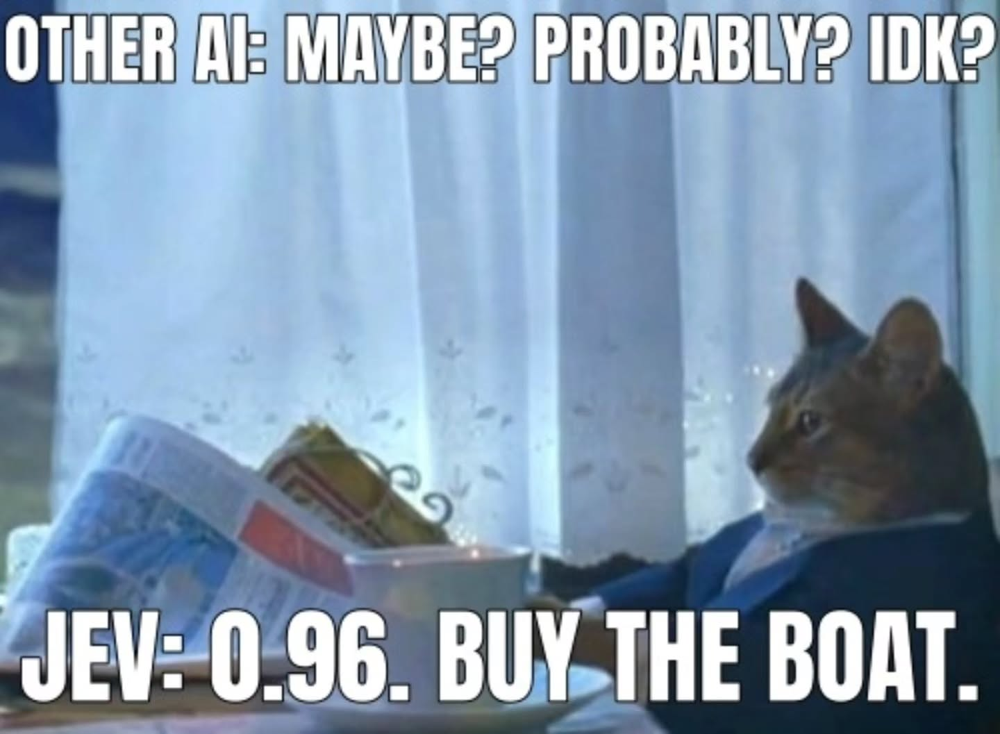
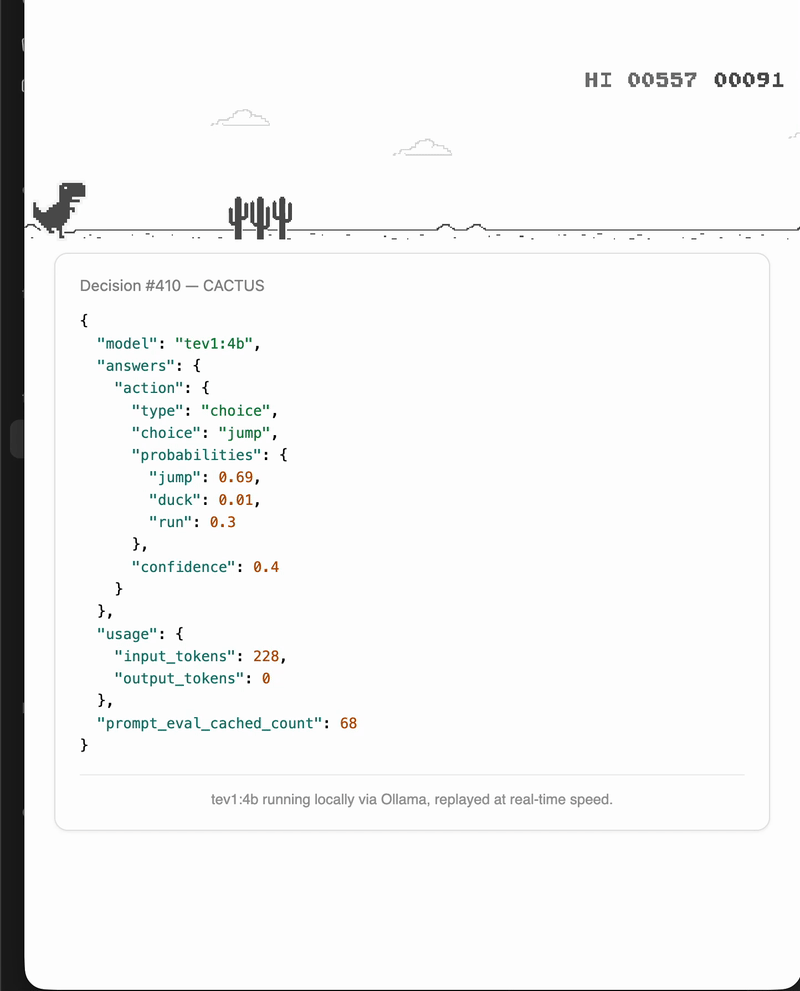

I had, in a moment I can only call optimism, installed a small “decision model” called tev1 via Ollama. Tev1 is a family of open-weight, Jev-inspired decision and text-classification models released by Together AI and available in 4B and 0.8B parameter sizes fine-tuned from Qwen3.5.

If you are hearing about Jev for the first time - it is a chat-less, pick-more kinda LLM model. "Unlike standard conversational language models that output free-form text, Tev1 takes a structured input state, a question, and 2 to 24 labeled options, returning a specific option choice and probability distribution". And it picks one, like a man at a buffet who has already decided on the fish.

Naturally I pointed it at the Chrome dino game. Its only natural because my official laptop's official game-allowances only allow for a Chrome browser. The dino, you’ll recall, has one job: jump, duck, or stand there like a chump. A 4B model seemed exactly qualified for a job with three possible wrong answers.

Next, Claude rigged Playwright to drive the actual game and feed tev1 the details each time trouble approached: a cactus here, a pterodactyl there, going this fast. Whatever it said, jump or duck or nothing, the dino did. If it ducked a cactus, it ducked the cactus, and paid for it in full.

Results were mixed - it once ducked a pterodactyl skimming along at ground level, the exact sort you’re meant to leap over, with the confidence of a man backing his car with confidence after a few too many beer. The dino hasn't, to date, broken the 2000 points ceiling. It has, however, broken several personal records for dying in novel ways. Improvement to its reaction-time will follow soon and code is [here](https://github.com/fx86/chrome-dino-game/).
